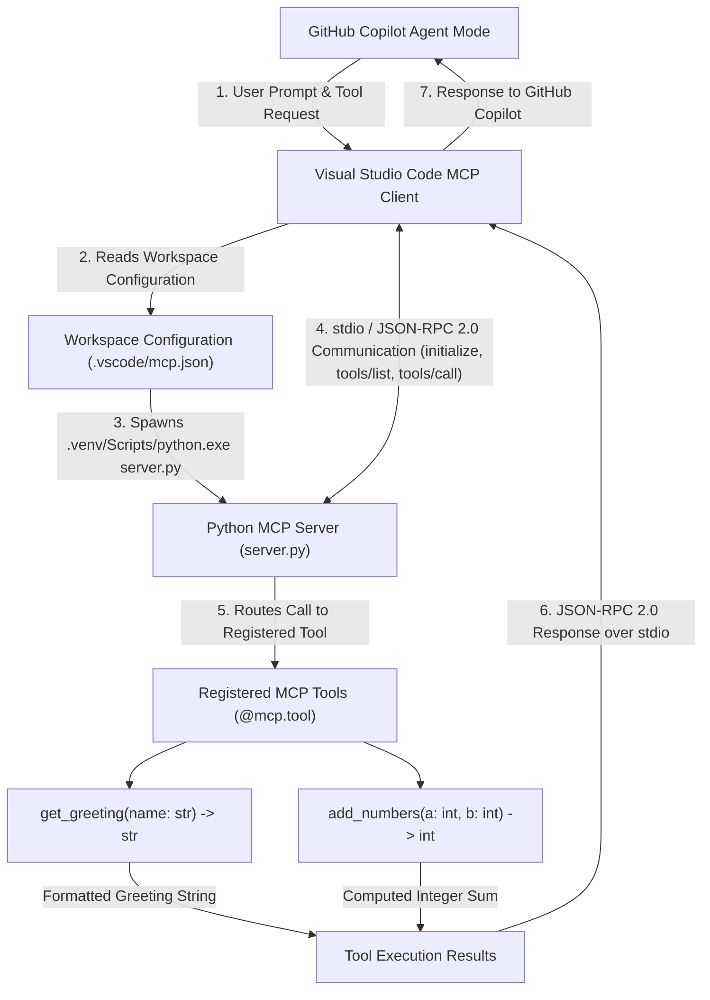

**Name:** Sumana Sri  
**Roll No:** 261FB04017

---

# Hello MCP – Python Model Context Protocol Server


**Hello MCP** (`hello-mcp`) is a standards-compliant **Model Context Protocol (MCP)** server implemented in Python `3.12.10` using the official MCP Python SDK (`mcp==2.3.0` with `mcp[cli]`). It exposes deterministic, strongly typed Python functions—`get_greeting` and `add_numbers`—as structured MCP tools over standard input/output (`stdio`) using JSON-RPC 2.0, enabling seamless tool discovery and execution inside **Visual Studio Code** with **GitHub Copilot Agent Mode**.

---

## Table of Contents

1. [Project Overview](#1-project-overview)
2. [Problem Statement](#2-problem-statement)
3. [Project Objectives](#3-project-objectives)
4. [What is Model Context Protocol?](#4-what-is-model-context-protocol)
5. [Why MCP Servers Are Useful](#5-why-mcp-servers-are-useful)
6. [Technology Stack](#6-technology-stack)
7. [System Architecture Diagram](#7-system-architecture-diagram)
8. [Project Directory Structure](#8-project-directory-structure)
9. [File and Directory Descriptions](#9-file-and-directory-descriptions)
10. [Complete Python Server Implementation](#10-complete-python-server-implementation)
11. [Explanation of `server.py`](#11-explanation-of-serverpy)
12. [Detailed Explanation of MCP Tool 1 (`get_greeting`)](#12-detailed-explanation-of-mcp-tool-1-get_greeting)
13. [Detailed Explanation of MCP Tool 2 (`add_numbers`)](#13-detailed-explanation-of-mcp-tool-2-add_numbers)
14. [Generated JSON Schema Examples](#14-generated-json-schema-examples)
15. [Python Environment Setup](#15-python-environment-setup)
16. [Installation Instructions (Windows PowerShell)](#16-installation-instructions-windows-powershell)
17. [MCP Server Configuration](#17-mcp-server-configuration)
18. [Configuration Property Explanations](#18-configuration-property-explanations)
19. [Server Execution Instructions](#19-server-execution-instructions)
20. [Testing and Verification](#20-testing-and-verification)
21. [Actual Successful Test Outputs](#21-actual-successful-test-outputs)
22. [GitHub Copilot Agent Mode Integration](#22-github-copilot-agent-mode-integration)
23. [Screenshot Evidence Section](#23-screenshot-evidence-section)
24. [Learning Outcomes](#24-learning-outcomes)
25. [Future Enhancements](#25-future-enhancements)
26. [Academic Project Information](#26-academic-project-information)

---

## 1. Project Overview

**Hello MCP** demonstrates the end-to-end engineering workflow for building, configuring, and verifying a local Python Model Context Protocol server:

- **How Python Functions Become MCP Tools:** Standard Python functions in `server.py` are decorated with `@mcp.tool()` on an `MCPServer("Hello MCP")` instance. At registration time, the SDK inspects each function's name, docstring, and type annotations (`str`, `int`) to build an MCP tool definition and JSON Schema automatically.
- **How an MCP Client Discovers and Invokes Tools:** When the server starts, the MCP client performs a JSON-RPC 2.0 `initialize` handshake, sends a `tools/list` request to retrieve all registered tool schemas, and invokes individual tools using `tools/call` with validated JSON arguments.
- **How VS Code and GitHub Copilot Interact with This Server:** Visual Studio Code reads `.vscode/mcp.json`, launches `server.py` using the project's isolated `.venv` Python interpreter, and exposes the discovered tools (`get_greeting` and `add_numbers`) to GitHub Copilot Agent Mode.
- **Why `stdio` Communication Is Used:** Standard input/output (`stdio`) provides a low-latency, zero-network-configuration transport for local IDE tools. The client writes JSON-RPC requests to the server's `stdin` and reads JSON-RPC responses from its `stdout`, avoiding local port conflicts or firewall rules.

---

## 2. Problem Statement

Large Language Model (LLM) assistants integrated into modern IDEs excel at natural language reasoning and code synthesis, but they cannot natively execute deterministic local Python functions or access external runtime state without custom, vendor-specific integration glue code. Developers need a standardized, transport-agnostic protocol that allows an IDE host (such as Visual Studio Code with GitHub Copilot) to discover, validate, and invoke local Python tools safely and reproducibly.

---

## 3. Project Objectives

1. **Provision an Isolated Runtime:** Create a dedicated Python `3.12.10` virtual environment (`.venv`) containing the official MCP Python SDK (`mcp==2.3.0` installed with `mcp[cli]`) and record all pinned packages in `requirements.txt`.
2. **Implement an MCP Server:** Develop `server.py` using `MCPServer` from `mcp.server.mcpserver` with the server identifier `"Hello MCP"`.
3. **Expose Strongly Typed Python Tools:**
   - `get_greeting(name: str) -> str`: Returns a formatted greeting string for a student.
   - `add_numbers(a: int, b: int) -> int`: Computes and returns the deterministic integer sum of two integers.
4. **Configure Portable IDE Discovery:** Author `.vscode/mcp.json` using the portable `${workspaceFolder}` variable so Visual Studio Code spawns the server inside `.venv` over `stdio`.
5. **Perform Multi-Layer Verification:** Validate the server through direct Python function calls, asynchronous `stdio` JSON-RPC protocol client handshakes, and interactive GitHub Copilot Agent Mode prompts.

---

## 4. What is Model Context Protocol?

The **Model Context Protocol (MCP)** is an open protocol that standardizes how AI applications (hosts and clients) connect to external tools, prompts, and resources (servers). Built on top of **JSON-RPC 2.0**, MCP defines a structured lifecycle:

1. **Initialization (`initialize`):** The client and server exchange protocol versions and capability declarations.
2. **Discovery (`tools/list`):** The client requests the list of available tools, receiving each tool's name, description, and JSON Schema for input parameters.
3. **Execution (`tools/call`):** The client invokes a specific tool by passing arguments conforming to its JSON Schema, and the server returns structured content blocks containing the execution output.

---

## 5. Why MCP Servers Are Useful

- **Deterministic Accuracy:** Tasks such as arithmetic calculations, string formatting, or data queries are executed by exact Python code rather than probabilistic LLM token prediction.
- **Write Once, Connect Anywhere:** Any MCP-compliant client (such as Visual Studio Code, GitHub Copilot Agent Mode, or custom `mcp.client` scripts) can interact with the same `server.py` implementation without code changes.
- **Automatic Schema Validation:** By leveraging Python type hints and Pydantic (`pydantic==2.14.3`), the server automatically enforces input types (`str`, `int`) before executing business logic.
- **Process and Dependency Isolation:** Each MCP server runs in its own OS subprocess and Python virtual environment (`.venv`), keeping host environments clean and secure.

---

## 6. Technology Stack

Every component and version listed below has been verified directly from the project's `.venv` environment and `requirements.txt`:

| Category | Technology | Verified Version | Role in Project |
| :--- | :--- | :--- | :--- |
| **Programming Language** | Python | `3.12.10` | Core runtime interpreter executing `server.py` |
| **MCP SDK** | `mcp` (`mcp[cli]`), `mcp-types` | `2.3.0` | Model Context Protocol server (`MCPServer`), client, and CLI framework |
| **Virtual Environment** | Python `venv` | `.venv` (Python `3.12.10`) | Isolated project environment housing `.venv\Scripts\python.exe` and 38 packages |
| **Data Validation** | `pydantic`, `pydantic_core` | `2.14.3`, `2.50.4` | Function signature introspection and tool argument validation |
| **JSON Schema Engine** | `jsonschema`, `jsonschema-specifications` | `4.26.0`, `2025.9.1` | Generation and verification of MCP tool input schemas |
| **Asynchronous Runtime** | `anyio` | `4.16.0` | Async task groups and non-blocking `stdio` stream management |
| **Transport Protocol** | JSON-RPC 2.0 over `stdio` | JSON-RPC `2.0` | Bidirectional message framing over standard input and standard output |
| **IDE & MCP Client** | Visual Studio Code | Workspace MCP Client | Reads `.vscode/mcp.json`, manages server lifecycle, and discovers tools |
| **AI Assistant** | GitHub Copilot | Agent Mode | Interprets natural language prompts and invokes discovered `helloMcp` tools |
| **Command Shell** | Windows PowerShell | Windows 10 / 11 | Environment setup, package installation, and CLI protocol verification |

---

## 7. System Architecture Diagram

The following Mermaid diagram illustrates the complete architectural flow from a user prompt in GitHub Copilot Agent Mode through Visual Studio Code, `.vscode/mcp.json`, `server.py`, `stdio` / JSON-RPC 2.0 communication, tool execution, and back to GitHub Copilot:



---

## 8. Project Directory Structure

The actual verified directory structure of the `hello-mcp` workspace is:

```text
hello-mcp/
├── .venv/
├── .vscode/
│   └── mcp.json
├── server.py
├── requirements.txt
└── README.md
```

---

## 9. File and Directory Descriptions

| File / Folder Path | Type | Description |
| :--- | :--- | :--- |
| `.venv/` | Directory | Isolated Python `3.12.10` virtual environment containing the Python interpreter (`.venv\Scripts\python.exe`) and all 38 installed packages including `mcp==2.3.0`. |
| `.vscode/` | Directory | Workspace settings directory recognized automatically by Visual Studio Code. |
| `.vscode/mcp.json` | JSON File | Workspace MCP configuration registering the `helloMcp` server over `stdio` transport using `${workspaceFolder}\\.venv\\Scripts\\python.exe`. |
| `server.py` | Python File | Core MCP server script that instantiates `MCPServer("Hello MCP")`, defines `get_greeting` and `add_numbers`, and starts the server event loop via `mcp.run()`. |
| `requirements.txt` | Text File | UTF-8 dependency manifest pinning all 38 Python packages installed in `.venv` for reproducible environment creation. |
| `README.md` | Markdown File | Comprehensive engineering and M.Tech academic project documentation. |

---

## 10. Complete Python Server Implementation

Below is the exact, unmodified source code of `server.py`:

```python
from mcp.server.mcpserver import MCPServer
mcp = MCPServer("Hello MCP")

@mcp.tool()
def get_greeting(name: str) -> str:
    """Return a greeting for a student."""
    return f"Hello, {name}! Your first MCP tool works."

@mcp.tool()
def add_numbers(a: int, b: int) -> int:
    """Add two numbers."""
    return a + b

if __name__ == "__main__":
    mcp.run()
```

---

## 11. Explanation of `server.py`

| Line(s) | Code Statement | Technical Explanation |
| :--- | :--- | :--- |
| **Line 1** | `from mcp.server.mcpserver import MCPServer` | Imports the high-level `MCPServer` class from the official MCP Python SDK (`mcp==2.3.0`). |
| **Line 2** | `mcp = MCPServer("Hello MCP")` | Creates the server instance and assigns `"Hello MCP"` as the server name reported during the JSON-RPC `initialize` handshake. |
| **Line 4** | `@mcp.tool()` | Decorator that registers `get_greeting` in the server's tool catalog and generates its input JSON Schema from its type hints. |
| **Lines 5–7** | `def get_greeting(name: str) -> str:` | Defines a strongly typed function accepting `name: str`, documenting its purpose via a docstring (`"Return a greeting for a student."`), and returning the formatted greeting string. |
| **Line 9** | `@mcp.tool()` | Decorator that registers `add_numbers` in the server's tool catalog. |
| **Lines 10–12** | `def add_numbers(a: int, b: int) -> int:` | Defines a strongly typed function accepting two integers (`a: int`, `b: int`), with the docstring `"Add two numbers."`, returning `a + b`. |
| **Lines 14–15** | `if __name__ == "__main__": mcp.run()` | Standard Python entrypoint guard; invokes `mcp.run()`, which starts the asynchronous `stdio` JSON-RPC 2.0 server loop when `server.py` is executed directly. |

---

## 12. Detailed Explanation of MCP Tool 1 (`get_greeting`)

```python
@mcp.tool()
def get_greeting(name: str) -> str:
    """Return a greeting for a student."""
    return f"Hello, {name}! Your first MCP tool works."
```

- **Function Signature:** `get_greeting(name: str) -> str`
- **Tool Description (from Docstring):** `"Return a greeting for a student."`
- **Input Parameter:** `name` (required)
- **Input Type:** `str` (mapped to JSON Schema `"type": "string"`)
- **Return Type:** `str`
- **Function Behavior:** Interpolates the input `name` into an f-string template to produce a deterministic confirmation greeting.
- **Example Input:**
  ```json
  {"name": "Students"}
  ```
- **Verified Output:**
  ```text
  Hello, Students! Your first MCP tool works.
  ```

---

## 13. Detailed Explanation of MCP Tool 2 (`add_numbers`)

```python
@mcp.tool()
def add_numbers(a: int, b: int) -> int:
    """Add two numbers."""
    return a + b
```

- **Function Signature:** `add_numbers(a: int, b: int) -> int`
- **Tool Description (from Docstring):** `"Add two numbers."`
- **Input Parameters:** `a` (required), `b` (required)
- **Input Types:** `a: int`, `b: int` (both mapped to JSON Schema `"type": "integer"`)
- **Return Type:** `int`
- **Function Behavior:** Performs exact integer addition (`a + b`) and returns the resulting integer value.
- **Example Input:**
  ```json
  {"a": 10, "b": 20}
  ```
- **Verified Output:**
  ```text
  30
  ```

---

## 14. Generated JSON Schema Examples

When an MCP client sends a `tools/list` request to `server.py`, `MCPServer` (`mcp==2.3.0`) dynamically generates and returns the following verified JSON Schemas for the two tools:

### Verified JSON Schema for `get_greeting`

```json
{
  "title": "get_greetingArguments",
  "type": "object",
  "properties": {
    "name": {
      "title": "Name",
      "type": "string"
    }
  },
  "required": ["name"]
}
```

### Verified JSON Schema for `add_numbers`

```json
{
  "title": "add_numbersArguments",
  "type": "object",
  "properties": {
    "a": {
      "title": "A",
      "type": "integer"
    },
    "b": {
      "title": "B",
      "type": "integer"
    }
  },
  "required": ["a", "b"]
}
```

---

## 15. Python Environment Setup

Before installing packages, ensure **Python 3.12** is installed on Windows and accessible via the Windows Python Launcher (`py`):

1. Check available Python versions in Windows PowerShell:
   ```powershell
   py --version
   py -0p
   ```
2. Provision an isolated `.venv` directory bound to Python 3.12 inside the project root:
   ```powershell
   py -3.12 -m venv .venv
   ```
3. Verify that the virtual environment interpreter exists and reports `Python 3.12.10`:
   ```powershell
   .\.venv\Scripts\python.exe --version
   ```

---

## 16. Installation Instructions (Windows PowerShell)

Follow these exact steps in **Windows PowerShell** to clone, install, verify, and open the project:

### Step 1: Clone repository

```powershell
git clone https://github.com/ksumanasri/MCP-server.git
```

### Step 2: Enter repository directory

Navigate into the cloned repository folder (or if working inside the local workspace directory structure, navigate into `hello-mcp` where `server.py` is located):

```powershell
cd MCP-server
```
*(If `hello-mcp` is a subfolder or local workspace folder, run `cd hello-mcp` so your current working directory contains `server.py` and `requirements.txt`.)*

### Step 3: Create virtual environment

```powershell
py -3.12 -m venv .venv
```

### Step 4: Install dependencies

```powershell
.\.venv\Scripts\python.exe -m pip install -r requirements.txt
```

### Step 5: Verify Python

```powershell
.\.venv\Scripts\python.exe --version
```

### Step 6: Verify MCP SDK

```powershell
.\.venv\Scripts\python.exe -m pip show mcp
```

### Step 7: Open project in VS Code

```powershell
code .
```

### Step 8: Configure and start MCP server

Verify that `.vscode/mcp.json` is present in the workspace, open the VS Code Command Palette (`Ctrl + Shift + P`), run **`MCP: List Servers`**, select **`helloMcp`**, and click **Start** (or **Restart**).

---

## 17. MCP Server Configuration

The workspace MCP configuration is stored in `.vscode/mcp.json`. Below is the exact configuration used in this project:

```json
{
  "servers": {
    "helloMcp": {
      "type": "stdio",
      "command": "${workspaceFolder}\\.venv\\Scripts\\python.exe",
      "args": ["server.py"]
    }
  }
}
```

---

## 18. Configuration Property Explanations

| Property / Concept | Value in `.vscode/mcp.json` | Detailed Explanation |
| :--- | :--- | :--- |
| **`servers`** | `{ "helloMcp": { ... } }` | Root JSON object recognized by VS Code's MCP extension host to declare workspace-scoped MCP servers. |
| **`helloMcp`** | Server key | Unique logical name identifying this MCP server in the VS Code Server List and GitHub Copilot tool picker. |
| **`type`** | `"stdio"` | Instructs VS Code to communicate with the spawned server process over standard input/output (`stdin`/`stdout`) rather than HTTP/SSE. |
| **`command`** | `"${workspaceFolder}\\.venv\\Scripts\\python.exe"` | Exact executable launched by VS Code. Points directly to the project's isolated virtual environment Python binary. |
| **`args`** | `["server.py"]` | Array of command-line arguments passed to `python.exe`, instructing it to run `server.py` in the workspace root. |
| **`${workspaceFolder}`** | VS Code variable | Dynamically resolves to the absolute path of the open folder in VS Code, making `.vscode/mcp.json` portable across different Windows machines without hardcoded user paths. |
| **Virtual Environment Path** | `.venv\Scripts\python.exe` | Guarantees that `server.py` executes with `Python 3.12.10` and `mcp==2.3.0` installed in `.venv`, even if the global system Python lacks the MCP SDK. |
| **`stdio` Communication** | `stdin` / `stdout` streams | VS Code writes UTF-8 JSON-RPC 2.0 requests to the child process's `stdin` and parses JSON-RPC 2.0 responses emitted on `stdout`. |

---

## 19. Server Execution Instructions

Follow this step-by-step workflow to start and use the server inside **Visual Studio Code**:

1. **Open the Project Folder in VS Code:** Launch VS Code at the root of the project (`code .`) so `.vscode/mcp.json` and `server.py` are in the active workspace root.
2. **Open the Command Palette:** Press `Ctrl + Shift + P` on Windows.
3. **Run `MCP: List Servers`:** Type `MCP: List Servers` into the Command Palette and press `Enter`.
4. **Select `helloMcp`:** Click on the **`helloMcp`** server entry configured from `.vscode/mcp.json`.
5. **Start or Restart the Server:** Select **Start Server** (or **Restart Server** if already running).
6. **Confirm Two Tools Are Discovered:** Verify that the server status transitions to **Running** and reports **2 tools** (`get_greeting` and `add_numbers`).
7. **Open GitHub Copilot Chat:** Press `Ctrl + Alt + I` (or click the Copilot icon) and set the chat mode dropdown to **Agent**.
8. **Use the Available MCP Tools:** Submit natural language prompts instructing Copilot to call `get_greeting` or `add_numbers` from `helloMcp`.

---

## 20. Testing and Verification

Project verification is divided into three complementary testing methodologies:

### A. Direct Python Function Testing

Tests the underlying Python functions (`get_greeting` and `add_numbers`) by importing `server.py` directly inside the `.venv` interpreter.

**PowerShell Command:**
```powershell
& .\.venv\Scripts\python.exe -B -c "import server; print('Direct get_greeting:', repr(server.get_greeting('Students'))); print('Direct add_numbers:', repr(server.add_numbers(10, 20)))"
```

---

### B. End-to-End MCP `stdio` Protocol Testing

Spawns `server.py` as a child subprocess over `stdio` using `mcp.client.stdio.stdio_client` and `mcp.ClientSession` to verify the complete JSON-RPC 2.0 lifecycle:
- **Server Initialization:** Sends the `initialize` request and verifies `init.server_info` (`name='Hello MCP'`).
- **Tool Discovery (`tools/list`):** Queries the server for registered tools and inspects the count (`2`) and descriptions.
- **JSON Schema Inspection:** Verifies `t.input_schema` for both `get_greeting` and `add_numbers`.
- **Tool Invocation (`tools/call`):** Calls `get_greeting(name='Students')` and `add_numbers(a=10, b=20)` over `stdio` and verifies the returned text content.

**PowerShell Command:**
```powershell
& .\.venv\Scripts\python.exe -B -c "import asyncio; from mcp import ClientSession, StdioServerParameters; from mcp.client.stdio import stdio_client;
async def main():
    params = StdioServerParameters(command=r'.venv\Scripts\python.exe', args=['-B', 'server.py'])
    async with stdio_client(params) as (r, w):
        async with ClientSession(r, w) as s:
            init = await s.initialize()
            print('INITIALIZE:', init.server_info)
            tools = await s.list_tools()
            print('TOOLS DISCOVERED:', len(tools.tools))
            for i, t in enumerate(tools.tools, 1):
                print(f'  {i}. {t.name}: {t.description}')
                print(f'     Schema: {t.input_schema}')
            r1 = await s.call_tool('get_greeting', {'name': 'Students'})
            print('CALL get_greeting:', r1.content[0].text)
            r2 = await s.call_tool('add_numbers', {'a': 10, 'b': 20})
            print('CALL add_numbers:', r2.content[0].text)
asyncio.run(main())"
```

---

### C. Interactive GitHub Copilot Agent Mode Testing

Evaluates end-to-end tool selection and execution inside Visual Studio Code's GitHub Copilot Chat (Agent Mode) using natural language prompts (detailed in [Section 22](#22-github-copilot-agent-mode-integration)).

---

## 21. Actual Successful Test Outputs

All outputs below were captured directly from the project's `.venv` environment (`Python 3.12.10`, `mcp==2.3.0`):

### 1. Environment and Package Verification Output

```text
Python 3.12.10
Name: mcp
Version: 2.3.0
Summary: Model Context Protocol SDK
Home-page: https://modelcontextprotocol.io
Author: Model Context Protocol a Series of LF Projects, LLC.
License: MIT
Requires: anyio, httpx2, jsonschema, mcp-types, opentelemetry-api, pydantic, pyjwt, python-multipart, pywin32, sse-starlette, starlette, typing-extensions, typing-inspection, uvicorn
```

### 2. Direct Python Function Execution Output

```text
Direct get_greeting: 'Hello, Students! Your first MCP tool works.'
Direct add_numbers: 30
```

### 3. End-to-End MCP `stdio` Protocol Client Output

```text
INITIALIZE: name='Hello MCP' title=None version='' description=None website_url=None icons=None
TOOLS DISCOVERED: 2
  1. get_greeting: Return a greeting for a student.
     Schema: {'properties': {'name': {'title': 'Name', 'type': 'string'}}, 'required': ['name'], 'type': 'object', 'title': 'get_greetingArguments'}
  2. add_numbers: Add two numbers.
     Schema: {'properties': {'a': {'title': 'A', 'type': 'integer'}, 'b': {'title': 'B', 'type': 'integer'}}, 'required': ['a', 'b'], 'type': 'object', 'title': 'add_numbersArguments'}
CALL get_greeting: Hello, Students! Your first MCP tool works.
CALL add_numbers: 30
```

### 4. Comprehensive Test Results Summary Table

| Test ID | Test Description | Testing Method | Input | Expected Output | Actual Output | Verification Status |
| :--- | :--- | :--- | :--- | :--- | :--- | :--- |
| **TC-01** | Direct Python call to `get_greeting` | Direct Python Import (`.venv`) | `name='Students'` | `'Hello, Students! Your first MCP tool works.'` | `'Hello, Students! Your first MCP tool works.'` | **Verified (CLI Executed)** |
| **TC-02** | Direct Python call to `add_numbers` | Direct Python Import (`.venv`) | `a=10, b=20` | `30` | `30` | **Verified (CLI Executed)** |
| **TC-03** | MCP Server Initialization Handshake | `mcp.client.stdio` JSON-RPC (`initialize`) | Protocol handshake request | `server_info.name = 'Hello MCP'` | `name='Hello MCP'` | **Verified (`stdio` Protocol)** |
| **TC-04** | MCP Tool & Schema Discovery | `mcp.client.stdio` JSON-RPC (`tools/list`) | Empty list request `{}` | `2` tools (`get_greeting`, `add_numbers`) with JSON Schemas | `TOOLS DISCOVERED: 2` with matching schemas | **Verified (`stdio` Protocol)** |
| **TC-05** | MCP `stdio` Execution of `get_greeting` | `mcp.client.stdio` JSON-RPC (`tools/call`) | `{"name": "Students"}` | `Hello, Students! Your first MCP tool works.` | `Hello, Students! Your first MCP tool works.` | **Verified (`stdio` Protocol)** |
| **TC-06** | MCP `stdio` Execution of `add_numbers` | `mcp.client.stdio` JSON-RPC (`tools/call`) | `{"a": 10, "b": 20}` | `30` | `30` | **Verified (`stdio` Protocol)** |
| **TC-07** | Copilot Agent Mode Greeting Demonstration | VS Code GitHub Copilot Chat (Agent Mode) | Prompt: *Use the get_greeting MCP tool from helloMcp with the name Students. Show me the result.* | `Hello, Students! Your first MCP tool works.` | `Hello, Students! Your first MCP tool works.` | **Demonstrated in VS Code Copilot** *(Screenshot file pending upload)* |
| **TC-08** | Copilot Agent Mode Addition Demonstration | VS Code GitHub Copilot Chat (Agent Mode) | Prompt: *Use the add_numbers MCP tool from helloMcp with a = 10 and b = 20. Show me the result.* | `30` | `30` | **Demonstrated in VS Code Copilot** *(Screenshot file pending upload)* |

---

## 22. GitHub Copilot Agent Mode Integration

When `helloMcp` is running in Visual Studio Code, **GitHub Copilot Agent Mode** connects to the server via the VS Code MCP Client and invokes both tools in response to natural language prompts:

### Demonstration 1: Greeting Tool Execution

**Greeting Test Prompt:**
```text
Use the get_greeting MCP tool from helloMcp with the name Students. Show me the result.
```

**Tool Invoked by Copilot:**
```json
{
  "server": "helloMcp",
  "tool": "get_greeting",
  "arguments": {
    "name": "Students"
  }
}
```

**Output:**
```text
Hello, Students! Your first MCP tool works.
```

---

### Demonstration 2: Addition Tool Execution

**Addition Test Prompt:**
```text
Use the add_numbers MCP tool from helloMcp with a = 10 and b = 20. Show me the result.
```

**Tool Invoked by Copilot:**
```json
{
  "server": "helloMcp",
  "tool": "add_numbers",
  "arguments": {
    "a": 10,
    "b": 20
  }
}
```

**Output:**
```text
30
```

> **Evidence Note:** Both tool executions above are verified at the protocol level over `stdio` (`TC-05` and `TC-06`) and demonstrated interactively in VS Code GitHub Copilot Agent Mode (`TC-07` and `TC-08`). To attach visual UI proof to the repository, add the corresponding screenshot files listed in [Section 23](#23-screenshot-evidence-section).

---

## 23. Screenshot Evidence Section

> **Repository Status:** Inspection of the current workspace confirmed that no image files (`.png`, `.jpg`) are currently stored in the directory. In accordance with strict documentation integrity standards, no fake images or broken Markdown image links have been inserted.

To attach visual evidence for academic evaluation, capture the following 5 screenshots in Visual Studio Code, save them in a `screenshots/` folder at the project root, and embed them using standard Markdown (``):

| # | Screenshot Title | What to Capture in Visual Studio Code | Suggested Relative Path | Current Status |
| :--- | :--- | :--- | :--- | :--- |
| **1** | **VS Code Project Structure** | VS Code Explorer sidebar displaying `.venv/`, `.vscode/mcp.json`, `README.md`, `requirements.txt`, and `server.py`. | `screenshots/01-vscode-project-structure.png` | Placeholder ready (add image file) |
| **2** | **MCP Configuration** | Editor tab showing `.vscode/mcp.json` with the `helloMcp` `stdio` configuration. | `screenshots/02-mcp-configuration.png` | Placeholder ready (add image file) |
| **3** | **MCP Server Running** | Command Palette (`MCP: List Servers`) or Output panel showing `helloMcp` in the **Running** state with 2 discovered tools. | `screenshots/03-mcp-server-running.png` | Placeholder ready (add image file) |
| **4** | **GitHub Copilot Greeting Tool Execution** | Copilot Chat (Agent Mode) executing the `get_greeting` prompt with `name = "Students"` and returning `Hello, Students! Your first MCP tool works.` | `screenshots/04-copilot-greeting-execution.png` | Placeholder ready (add image file) |
| **5** | **GitHub Copilot Addition Tool Execution** | Copilot Chat (Agent Mode) executing the `add_numbers` prompt with `a = 10` and `b = 20` and returning `30`. | `screenshots/05-copilot-addition-execution.png` | Placeholder ready (add image file) |

---

## 24. Learning Outcomes

Developing and verifying the **Hello MCP** project provided hands-on engineering proficiency across the following areas:

1. **MCP Architecture:** Understood the three-tier architecture linking an AI host (GitHub Copilot), an IDE MCP client (Visual Studio Code), and a local tool server (`server.py`).
2. **MCP Client-Server Communication:** Learned how client and server processes synchronize capabilities and exchange structured requests and responses without shared memory.
3. **Python MCP Server Development:** Built a clean, standards-compliant MCP server using `MCPServer` from `mcp.server.mcpserver` (`mcp==2.3.0`).
4. **Tool Registration:** Mastered exposing Python functions to AI agents declaratively using the `@mcp.tool()` decorator.
5. **Type Annotations:** Applied Python type hints (`name: str -> str`, `a: int, b: int -> int`) to enforce explicit contracts on tool inputs and outputs.
6. **JSON Schema Generation:** Observed how the MCP SDK and Pydantic introspect function signatures and docstrings to generate `get_greetingArguments` and `add_numbersArguments` schemas automatically.
7. **`stdio` Transport:** Configured standard input/output streams as a fast, zero-port-configuration communication channel for local subprocess servers.
8. **JSON-RPC 2.0:** Analyzed the underlying protocol methods (`initialize`, `tools/list`, and `tools/call`) used to discover and invoke tools.
9. **VS Code Configuration:** Authored a portable `.vscode/mcp.json` configuration leveraging `${workspaceFolder}` and `.venv\Scripts\python.exe`.
10. **GitHub Copilot Tool Integration:** Integrated local deterministic Python tools into GitHub Copilot Agent Mode for natural language invocation.
11. **Protocol-Level Testing:** Conducted end-to-end programmatic verification using `mcp.client.stdio` and `ClientSession` alongside direct unit testing.

---

## 25. Future Enhancements

*(Note: The items below represent planned future enhancements and are not currently implemented in `server.py`.)*

- **Additional Python MCP Tools:** Expand the server with string manipulation utilities, unit converters, date/time calculators, and academic grading tools.
- **External API Integration:** Utilize asynchronous HTTP libraries (`httpx2`) to query live weather services, public REST APIs, or documentation endpoints.
- **Database Connectivity:** Add MCP tools that perform parameterized queries against SQLite or PostgreSQL databases to retrieve student or project records safely.
- **File-Processing Tools:** Implement workspace-scoped tools capable of reading, summarizing, and validating CSV, JSON, and Markdown files.
- **Structured Logging:** Configure Python `logging` directed strictly to `sys.stderr` (preserving `sys.stdout` exclusively for JSON-RPC 2.0 protocol messages).
- **Error Handling:** Add custom exception handlers and input bounds checking to return descriptive MCP error payloads when invalid arguments are supplied.
- **Automated Testing Using `pytest`:** Build a dedicated `tests/` suite using `pytest` and `anyio` to run automated regression checks on all registered MCP tools.
- **GitHub Actions CI/CD:** Create a `.github/workflows/ci.yml` pipeline to automatically install `requirements.txt` and execute protocol verification tests on every push or pull request.

---

## 26. Academic Project Information

| Field | Details |
| :--- | :--- |
| **Student Name** | Sumana Sri |
| **Roll Number** | 261FB04017 |
| **Project Title** | Hello MCP – Python Model Context Protocol Server |
| **Programming Language** | Python (`3.12.10`) |
| **MCP SDK** | `2.3.0` (`mcp[cli]`) |
| **Development Environment** | Visual Studio Code (with GitHub Copilot Agent Mode) |
